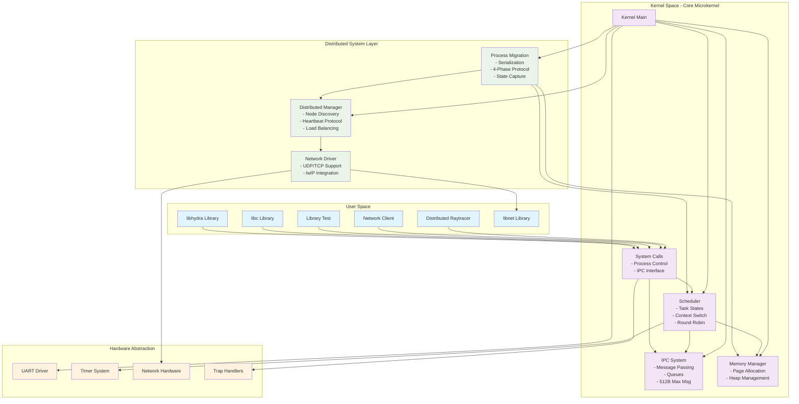

# Hydra Microkernel System Architecture

## Overview
This diagram shows the core microkernel architecture of Hydra with its distributed capabilities.

## Key Components

### Microkernel Core
- **Minimal kernel**: Only essential services in kernel space
- **Message-passing IPC**: All communication through messages
- **Preemptive scheduler**: Round-robin with context switching
- **Memory management**: Page-based allocation

### Distributed Layer
- **Node discovery**: Automatic detection of other kernel instances
- **Process migration**: Transparent process movement between nodes
- **Load balancing**: Intelligent workload distribution
- **Network services**: Built-in networking support

### Design Principles
1. **Separation of concerns**: Each component has clear responsibilities
2. **Modularity**: Components communicate only through well-defined interfaces
3. **Fault isolation**: User processes cannot crash the kernel
4. **Distributed transparency**: Applications unaware of node boundaries