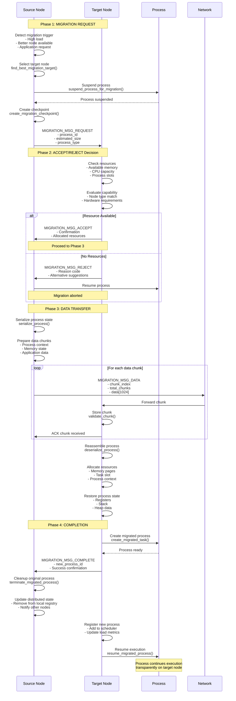
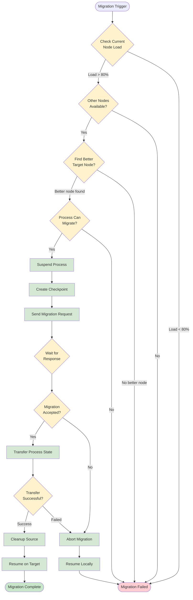

# Process Migration Protocol - 4-Phase Flow

## Overview
This diagram illustrates the complete 4-phase process migration protocol in Hydra, showing how processes are transparently moved between kernel nodes.

## Migration Decision Flow

## Protocol Details

### Phase 1: Request
- **Trigger conditions**: High load (>80%), better node available, manual request
- **Target selection**: Based on node type, capabilities, and current load
- **Process preparation**: Suspend execution, create checkpoint

### Phase 2: Negotiation  
- **Resource check**: Memory, CPU, process slots
- **Capability match**: Hardware requirements, node specialization
- **Policy enforcement**: Load balancing rules, security constraints

### Phase 3: Transfer
- **State serialization**: Complete process context capture
- **Chunked transfer**: 1KB chunks with error detection
- **Progressive restore**: Incremental process reconstruction

### Phase 4: Completion
- **Process activation**: Resume execution on target
- **State synchronization**: Update distributed system state
- **Resource cleanup**: Free resources on source node

## Error Handling
- **Network failures**: Automatic retry with exponential backoff
- **Resource exhaustion**: Graceful rejection with alternatives
- **Corruption detection**: Checksums and validation at each step
- **Rollback capability**: Restore from checkpoint on failure