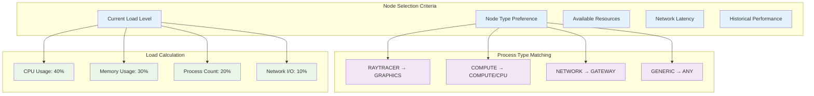

# Migration Decision Algorithm

## Overview
This diagram shows the intelligent decision-making process for when and where to migrate processes in the Hydra distributed system.

```mermaid
flowchart TD
    START([Process Migration<br/>Decision Point])
    
    %% Initial Triggers
    TRIGGER{Migration Trigger}
    LOAD_CHECK[Check Local Load<br/>calculate_node_load()]
    HIGH_LOAD{Load > 80%?}
    
    %% Node Discovery
    DISCOVER[Discover Available Nodes<br/>get_distributed_node_count()]
    ANY_NODES{Other Nodes<br/>Available?}
    
    %% Process Analysis
    PROC_CHECK[Analyze Process<br/>get_process_type()]
    CAN_MIGRATE{Process Can<br/>Migrate?}
    ESTIMATE_SIZE[Estimate Migration Size<br/>estimate_migration_size()]
    
    %% Target Selection Algorithm
    SELECT_START[Start Target Selection]
    INIT_BEST[best_node = NULL<br/>lowest_load = 100]
    
    LOOP_START{For each node}
    CHECK_ALIVE{Node Status<br/>== ALIVE?}
    CHECK_TYPE{Node Type<br/>Matches Preference?}
    CHECK_LOAD_CMP{Node Load <<br/>lowest_load?}
    UPDATE_BEST[Update Best Node<br/>best_node = current<br/>lowest_load = current.load]
    NEXT_NODE[Next Node]
    
    %% Final Decision
    BEST_FOUND{Best Node<br/>Found?}
    LOAD_BENEFIT{Load Improvement<br/>> 20%?}
    
    %% Migration Execution
    INITIATE[Initiate Migration<br/>migrate_process_to_node()]
    MONITOR[Monitor Migration<br/>Progress]
    
    %% Results
    SUCCESS([Migration<br/>Successful])
    NO_MIGRATION([No Migration<br/>Required])
    
    %% Flow connections
    START --> TRIGGER
    
    TRIGGER -->|High Load| LOAD_CHECK
    TRIGGER -->|Manual Request| PROC_CHECK
    TRIGGER -->|Better Node Available| DISCOVER
    TRIGGER -->|Periodic Check| LOAD_CHECK
    
    LOAD_CHECK --> HIGH_LOAD
    HIGH_LOAD -->|Yes| DISCOVER
    HIGH_LOAD -->|No| NO_MIGRATION
    
    DISCOVER --> ANY_NODES
    ANY_NODES -->|Yes| PROC_CHECK
    ANY_NODES -->|No| NO_MIGRATION
    
    PROC_CHECK --> CAN_MIGRATE
    CAN_MIGRATE -->|Yes| ESTIMATE_SIZE
    CAN_MIGRATE -->|No| NO_MIGRATION
    
    ESTIMATE_SIZE --> SELECT_START
    SELECT_START --> INIT_BEST
    INIT_BEST --> LOOP_START
    
    LOOP_START -->|More nodes| CHECK_ALIVE
    LOOP_START -->|No more nodes| BEST_FOUND
    
    CHECK_ALIVE -->|Yes| CHECK_TYPE
    CHECK_ALIVE -->|No| NEXT_NODE
    
    CHECK_TYPE -->|Match or Any| CHECK_LOAD_CMP
    CHECK_TYPE -->|No match| NEXT_NODE
    
    CHECK_LOAD_CMP -->|Yes| UPDATE_BEST
    CHECK_LOAD_CMP -->|No| NEXT_NODE
    
    UPDATE_BEST --> NEXT_NODE
    NEXT_NODE --> LOOP_START
    
    BEST_FOUND -->|Yes| LOAD_BENEFIT
    BEST_FOUND -->|No| NO_MIGRATION
    
    LOAD_BENEFIT -->|Yes| INITIATE
    LOAD_BENEFIT -->|No| NO_MIGRATION
    
    INITIATE --> MONITOR
    MONITOR --> SUCCESS
    
    classDef decision fill:#fff2cc,stroke:#d6b656
    classDef process fill:#d5e8d4,stroke:#82b366
    classDef start_end fill:#f8cecc,stroke:#b85450
    classDef algorithm fill:#e1d5e7,stroke:#9673a6
    
    class TRIGGER,HIGH_LOAD,ANY_NODES,CAN_MIGRATE,LOOP_START,CHECK_ALIVE,CHECK_TYPE,CHECK_LOAD_CMP,BEST_FOUND,LOAD_BENEFIT decision
    class LOAD_CHECK,DISCOVER,PROC_CHECK,ESTIMATE_SIZE,INITIATE,MONITOR process
    class START,SUCCESS,NO_MIGRATION start_end
    class SELECT_START,INIT_BEST,UPDATE_BEST,NEXT_NODE algorithm
```

## Load Balancing Algorithm Details



## Decision Matrix

| Condition | Threshold | Action | Priority |
|-----------|-----------|--------|----------|
| Local Load | > 80% | Seek migration target | High |
| Better Node Load | < (Current - 20%) | Consider migration | Medium |
| Node Specialization | Type match | Prefer specialized nodes | High |
| Network Latency | < 100ms | Allow migration | Medium |
| Process Size | < 8MB | Allow migration | Low |
| Migration History | < 3 recent failures | Allow migration | Medium |

## Code Implementation

```c
// Core decision algorithm from the codebase
uint32_t get_best_compute_node_id(void) {
    kernel_node_t *best_node = NULL;
    uint32_t lowest_load = 100;
    
    // Find the compute node with the lowest load
    for (int i = 0; i < dist_system.num_nodes; i++) {
        kernel_node_t *node = &dist_system.nodes[i];
        
        if (node->type == NODE_TYPE_COMPUTE && 
            node->status == NODE_STATUS_ALIVE &&
            node->load < lowest_load &&
            node->node_id != dist_system.local_node_id) {
            
            best_node = node;
            lowest_load = node->load;
        }
    }
    
    return best_node ? best_node->node_id : 0;
}

// Migration decision logic
bool should_migrate_to_better_node(void) {
    int node_count = get_distributed_node_count();
    if (node_count <= 1) return false;  // No other nodes
    
    uint32_t best_node = get_best_compute_node_id();
    uint32_t local_node = get_local_node_id();
    
    return (best_node != local_node);  // Migrate if better node found
}
```

## Performance Considerations

### Migration Triggers
1. **Load-based**: Automatic when load exceeds threshold
2. **Opportunistic**: When significantly better nodes become available  
3. **Application-requested**: Explicit migration requests
4. **Periodic**: Regular load balancing checks

### Optimization Strategies
- **Hysteresis**: Prevent oscillating migrations
- **Cooling period**: Minimum time between migrations
- **Batch migration**: Group related processes
- **Predictive**: Use load trends for decisions

### Failure Handling
- **Retry logic**: Exponential backoff for failed migrations
- **Fallback**: Alternative target selection
- **Rollback**: Return to source on critical failures
- **Circuit breaker**: Temporarily disable problematic routes