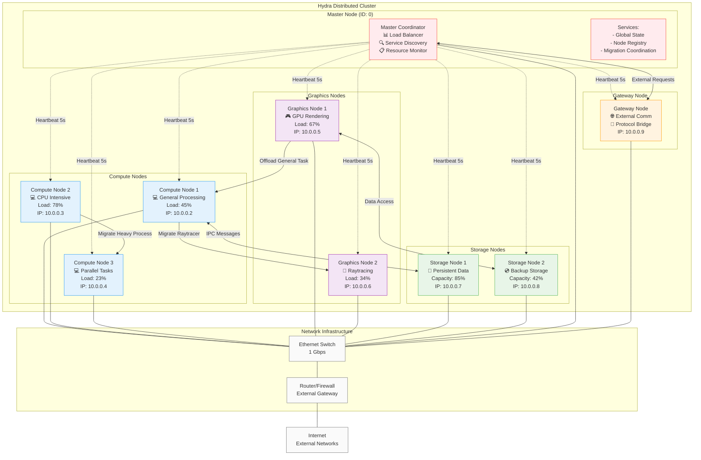
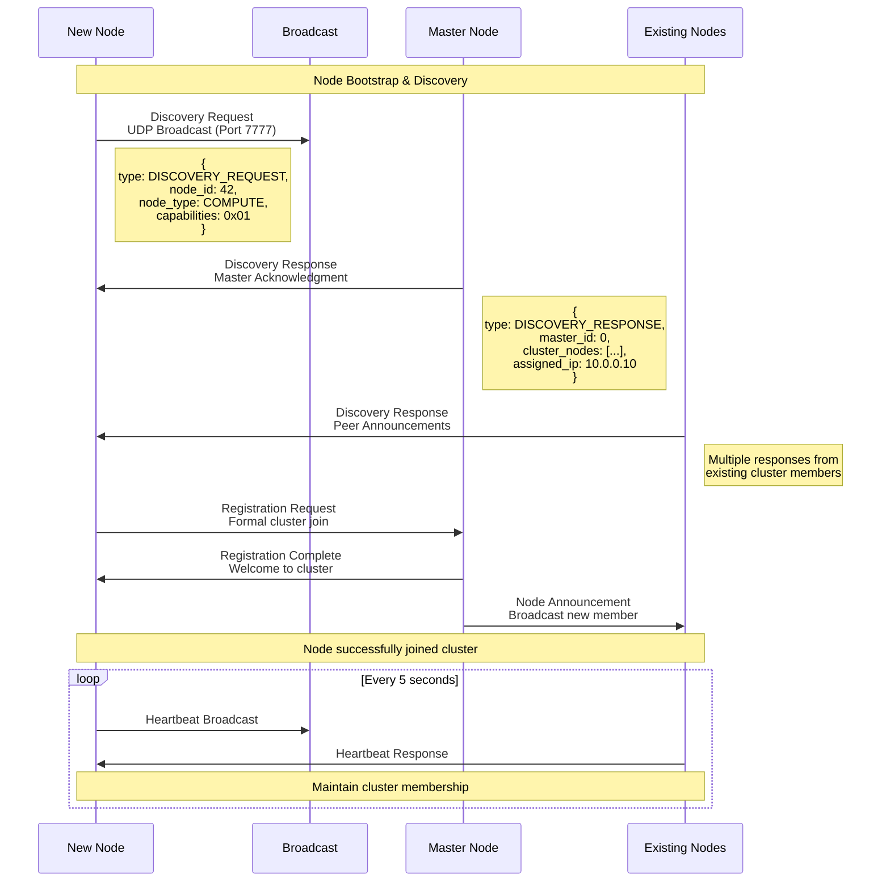
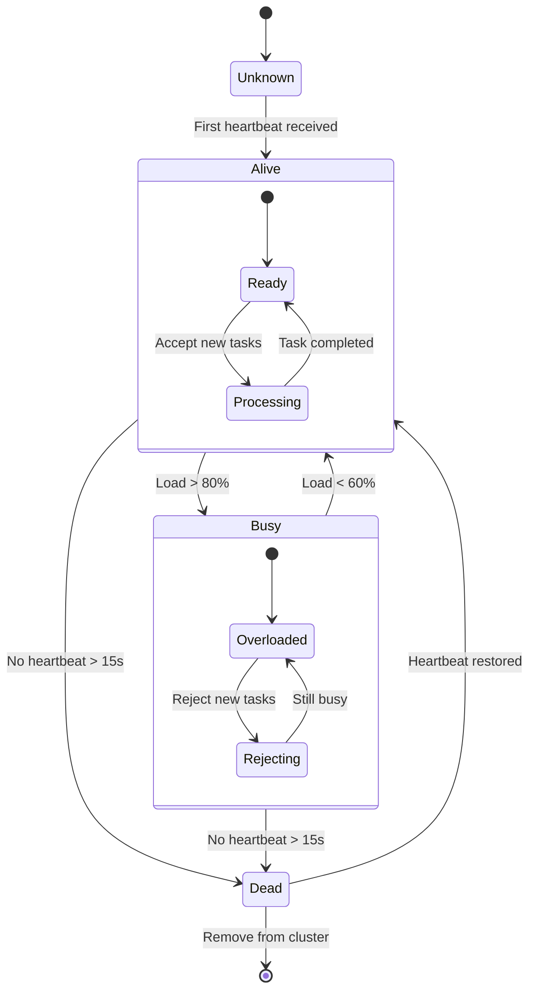
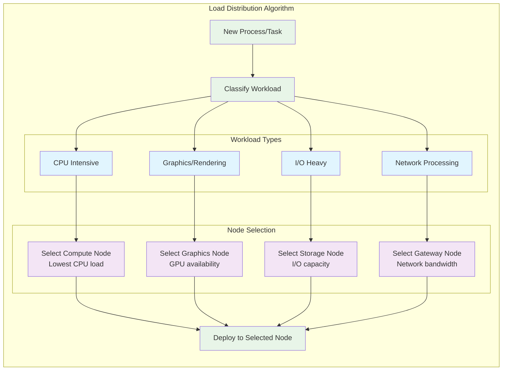

# Distributed System Topology

## Overview
This diagram shows the distributed network topology of Hydra microkernel nodes, their specializations, and communication protocols.



## Node Discovery Protocol



## Heartbeat & Health Monitoring



## Load Balancing Strategy



## Network Communication Protocols

### Discovery Protocol (UDP Port 7777)
```c
typedef struct {
    uint32_t magic;           // 0xDEADBEEF
    uint8_t type;            // DISCOVERY_REQUEST/RESPONSE
    uint32_t node_id;        // Unique node identifier
    node_type_t node_type;   // Node specialization
    uint32_t capabilities;   // Capability flags
    uint32_t ip_addr;        // Node IP address
    char node_name[32];      // Human-readable name
} discovery_packet_t;
```

### Migration Protocol (TCP Port 7778)
```c
typedef struct {
    migration_msg_type_t type;  // Message type
    uint32_t process_id;        // Process identifier
    uint32_t data_size;         // Payload size
    uint32_t sequence;          // Message sequence
    uint32_t total_chunks;      // Total data chunks
    uint32_t chunk_index;       // Current chunk index
    uint8_t data[1024];         // Payload data
} migration_message_t;
```

### Heartbeat Protocol (UDP Port 7779)
```c
typedef struct {
    uint32_t node_id;         // Source node ID
    uint64_t timestamp;       // Current timestamp
    uint32_t load_percent;    // Current load (0-100)
    uint32_t memory_used;     // Memory usage
    uint32_t active_processes;// Process count
    node_status_t status;     // Node status
} heartbeat_packet_t;
```

## Fault Tolerance Features

1. **Node Failure Detection**
   - Heartbeat timeout (15 seconds)
   - Automatic cluster reorganization
   - Process migration from failed nodes

2. **Network Partition Handling**
   - Split-brain prevention
   - Master election protocol
   - Graceful degradation

3. **Load Balancing**
   - Dynamic process redistribution  
   - Automatic load shedding
   - Performance-based routing

4. **Service Recovery**
   - Process checkpoint/restart
   - State replication
   - Transparent failover